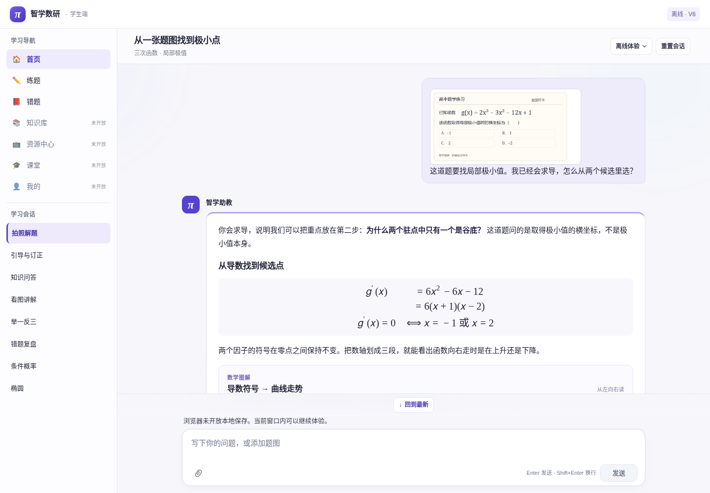
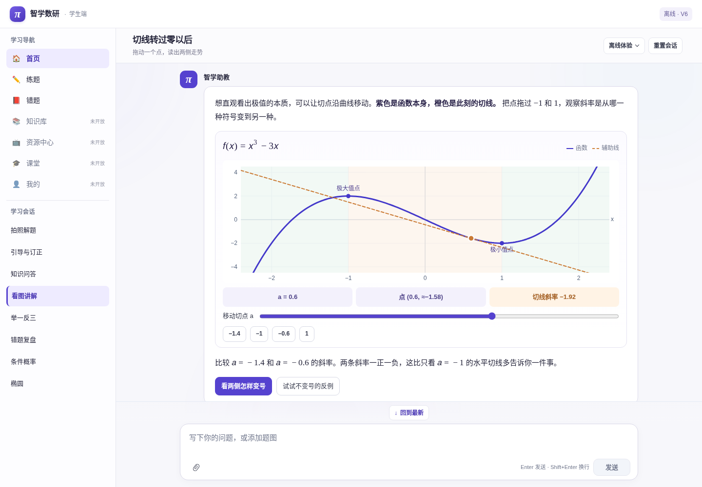
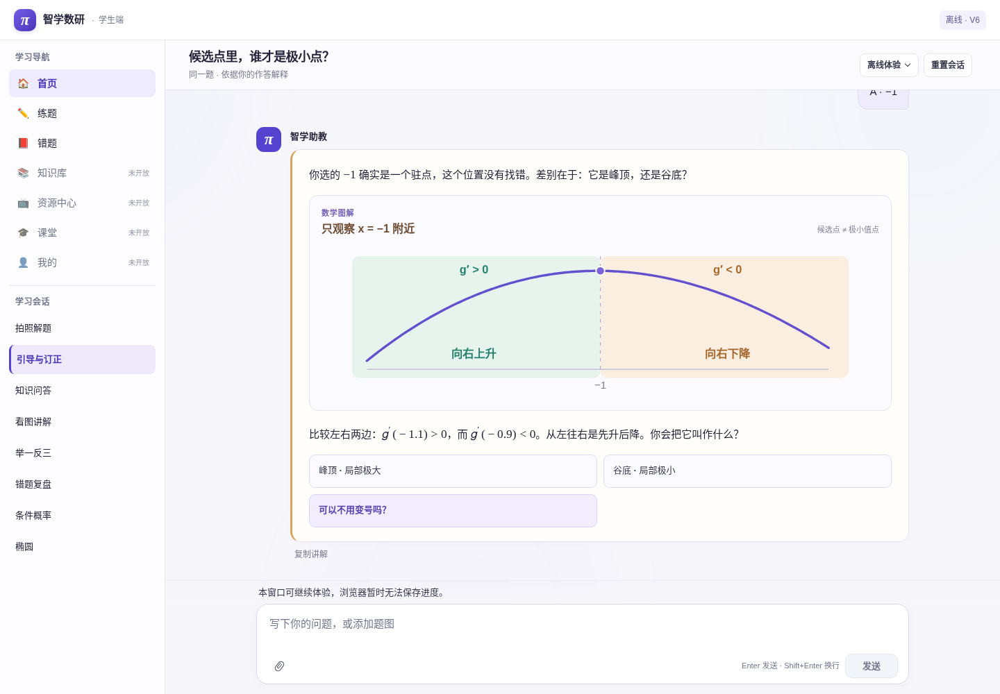
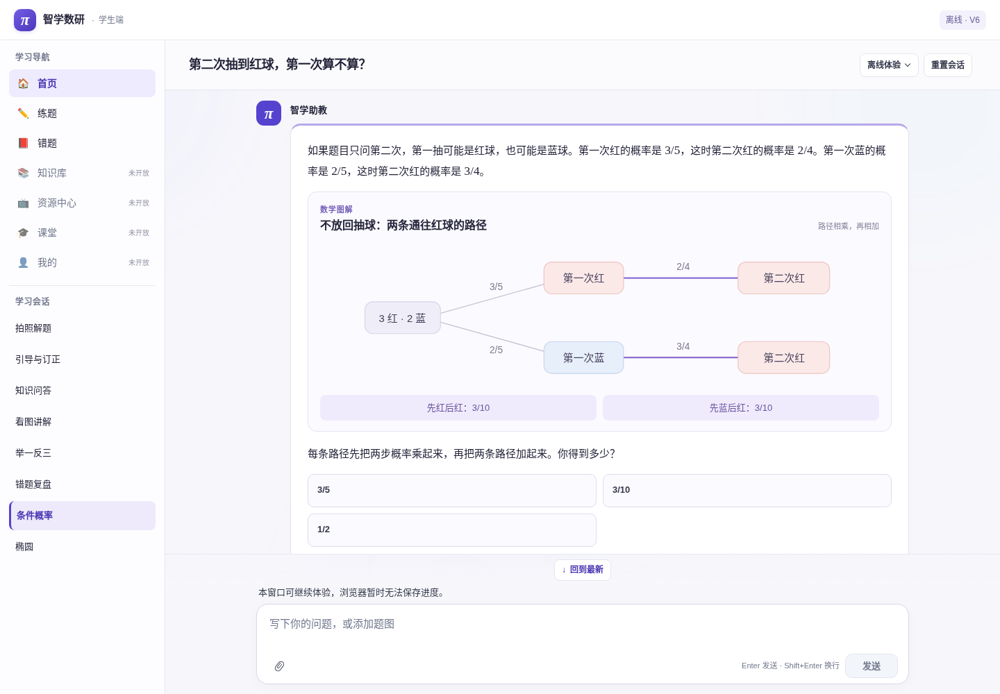
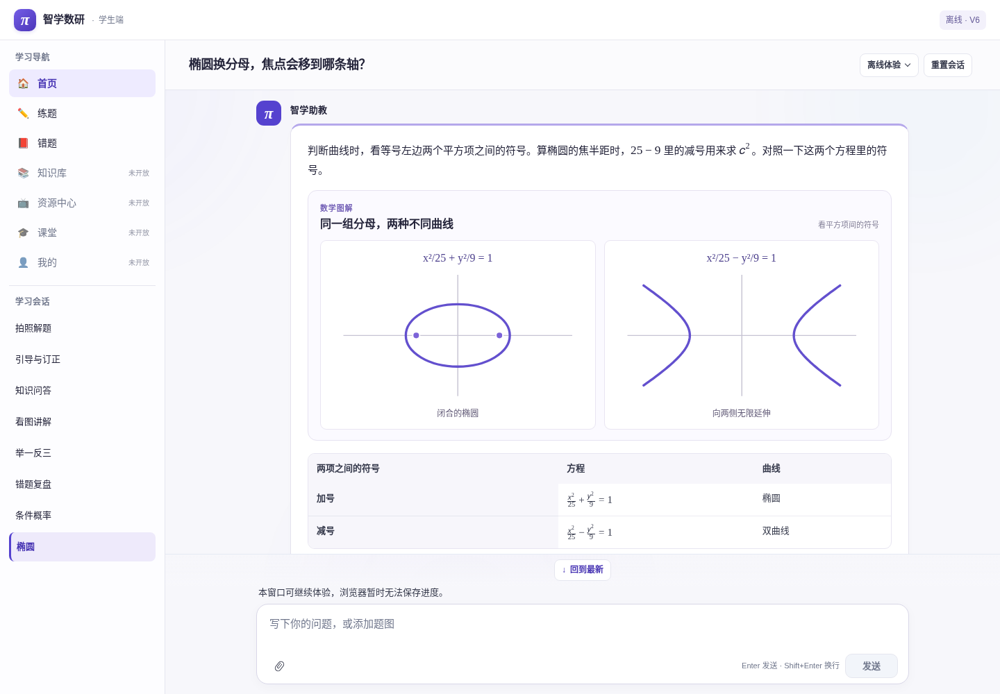

# 智学数研 · 学生端 AI 回答 V6

**V5 实际审计、市场设计研究与可操作修订** · 2026-11-25

## 0. 阅读及使用

直接打开同目录 `V6单文件离线预览.html`（现代 Chrome / Edge，推荐 1440×1000）。这是从用户 V5 预览代码实际改出的离线原型，不是重写正式项目、不是在线模型。图形、答题、分支与统计有实际前端行为；文本是预设样本。无后端，不支持任意题目和自由追问。图形、数学及界面预览全部可以离线使用。单文件版内嵌用户原包的 KaTeX JS、题图与讲义，使用浏览器原生 MathML，不附带字体文件。

源码修订目录可覆盖原 V5 资源包同名文件；新增 `visuals.js`，入口改为 `V6设计预览.html`，原 V5 vendor 与自编题图保留即可。请先备份原 V5。不要把此独立预览直接覆盖实际 Vue 发行包。原 V5 单元测试不等同于 V6 测试；新的运行数据以 `resources/samples/V6预览数据.json` 为准，原 V5 样本、审核文档和截图并未被改写。

## 1. V5 审计：为什么单调？

本轮阅读了 V5 包中的主设计说明、`V5设计预览.html`、`preview.css`、`preview.js`、`charts.js`、`data.js`、官方参考资料以及 13 张 mockup（12 张桌面状态、1 张移动端）。V5 的长处在于已具有独立的预设分支、数学公式、动态图形、实际提交记录、来源弹窗和能力边界。核心弱点不是缺少基础能力，而是视觉与内容结构的同质化。

| 证据 | 问题 | 修订决策 |
|---|---|---|
| `preview.js` 的 `render()` 对全部 assistant 创建同一种 `reply-panel` | 简答、深度解析、实验、练习、记录的视觉重量相近 | 根据内容类型选 compact / editorial / lab / feedback / practice / record |
| `preview.css` 的 `.reply-panel` 总是白底、同一边框、同一内边距 | 统一变成重复，阅读节奏不足 | 保留轻边界，增加按教学目的划分的结构与局部色彩 |
| `blockFor()` 主要支持 p/math/note/table/figure/problem/source/review | 表格重复承担图解、诊断、总结任务 | 新增教学图解 `visual` 和章节 `heading`；只在有意义处使用 |
| `charts.js` 的图形由 slider 及 presets 控制 | 文案要求“拖动点”，原 V5 画布未监听 pointer | 增加点击/拖动改变参数，保留键盘滑块 |
| `commitAction()` 对选答案只写 `selected`，不追加学生消息 | 回放中常见两个 AI 轮次，学生答案成为灰色状态 | 提交答案生成学生消息并记录；图形操作和展开动作不冒充学生聊天 |
| S01 知识问答、S02 拍照、S03 练习、S04 纠错、S08 概率与解析几何 | 文字、表格、白框在不同知识主题里反复出现 | 概念对照图、变号轨迹、峰顶局部图、概率树、圆锥曲线图分别承担不同教学任务 |

V5 有可操作功能，因此不重建所有会话。设计原则由“克制所有视觉”转为“克制外壳、突出学科内容”。评价是截图与源码设计判断，不是用户实验结果。

## 2. 市场研究：从产品机制到具体视觉规则

核对日期：2026-11-25。采用厂商官方公开产品资料及示例、技术文档。未登录测试这些竞品，也没有以检索缩略图替代证据。以下链接可直接查看公开演示。表中“可移植规则”是本项目设计推论。

| 产品及公开证据 | 具体观察 / 可核对能力 | 可移植规则 | 不照搬的地方 |
|---|---|---|---|
| [ChatGPT 数学科学互动](https://openai.com/index/new-ways-to-learn-math-and-science-in-chatgpt/) · [学习模式](https://openai.com/index/chatgpt-study-mode/) | 官方公告展示可调变量和实时变化的图形；学习模式提供有层次的引导 | 图形和公式互相解释；普通回答和实验回答不必同构。每个数值随真实参数更新 | 不强制所有回答无边框，不声称预览可任意生成组件 |
| [Claude 行内视觉](https://claude.com/resources/articles/claude-builds-visuals) · [椭圆轨道示例](https://academy.claude.com/use-cases/visualize-the-mechanism-behind-an-explanation-mid-chat) | 轨道示例将椭圆、离心率滑块、能量信息和后续问题组合成主题专用界面；图形与正文连贯 | 概率树与函数图不应是同一种空白图卡；按数学问题设计信息布局 | 不把复杂生成式代码作为现场离线能力承诺 |
| [Gemini Guided Learning](https://blog.google/products-and-platforms/products/education/guided-learning/) · [学习路径示例](https://blog.google/products-and-platforms/products/gemini/guided-learning-google-gemini/) | 官方展示图示、视频、测验和学习路径；同题可采用直接回答或引导模式 | 已知学生错误就局部引导；只在有必要时切换到互动；答复要承接学生原话 | 不把所有题套进固定四步教学 |
| [Kimi 对话与智能体说明](https://www.kimi.com/help/new-user-guide/agentic-chat) | 官方文档支持多轮上下文、LaTeX 行内和块级表达、多模态输入 | 中文正文与公式的阅读层次一致；复杂公式独立展示；保留会话事实 | 没有获取真实登录界面，不断言其具体视觉尺寸或现有 UI 细节 |
| [Manus 事件接口](https://open.manus.im/docs/v2/task.listMessages) · [任务生命周期](https://open.manus.im/docs/v2/task-lifecycle) | 工具活动、计划更新、等待用户输入和结果具有不同事件 | 本地计算、作答、保存、引用分别呈现状态；不制造后台推理动画 | 不显示虚假的“已联网检索”“已验算”或未发生的任务步骤 |
| [Brilliant Koji](https://brilliant.org/help/features/how-does-koji-work/) · [数学教学机制](https://brilliant.org/resources/choosing-brilliant/how-brilliant-teaches-math/) | 导师可以感知共享画布上的题目与操作并标注当前困难；数学学习以移动点、判断、试验为主 | 让图形承担解释功能；学生答错后直接放大错处，下一步可操作 | 不把该产品的真实 AI 感知能力冒充当前离线脚本能力 |
| [Mathos AI Tutor](https://www.mathos.ai/feature/ai-tutor) · [Mathos 官网](https://www.mathos.ai/) | 官方描述数学白板逐步辅导和错误反馈 | 将学生的数学推导、判据及结果作为主体；必要时提供公式输入和逐步验证（后续） | 不将普通选择题视为完整解题过程 |
| [Desmos 图形计算器](https://www.desmos.com/calculator) · [GeoGebra](https://www.geogebra.org/) | 专业交互绘图工具，作为坐标、曲线、参数和辅助线参考 | 图上准确标识驻点、切线；变量操作有即时可读数值 | 不复制整套专业工作台或增加无功能控制项 |

### 2.1 回答视觉语法

- 简答：主语直接回应学生疑惑；短消息可采用收缩式轻边框，避免空标题和空大卡。
- 深度解析：章节、独立公式、关键推导图、结论；主要依据应与数学对象绑定。避免堆叠小卡。
- 实验：数学对象成为第一主角；独立画布、有效参数、当前值与解释联动。可拖动、可通过键盘滑块控制。
- 纠错：引用学生的实际答案，突出特定数学位置；颜色只表达真正有意义的区别，如递增/递减、正确/错误。
- 练习：题面、选项、真实提交和分支反馈；下一题建立在本次答题结果上。
- 记录：仅记录实际发生的答题和保存；暂无记录时呈现空态。

### 2.2 用户操作与系统动作分离

学生发送、选择数学答案属于对话；展开解析、查看来源、切换实验参数属于 UI 行为。成功保存应有真实本地记录后再显示。预设离线内容不能声称正在运行模型，也不能把未知文本匹配成无关回答。

## 3. V6 实际实现

| 场景 | 实际改动 |
|---|---|
| 拍照题 | 从一句摘要展开成有层次的求导、变号、极值解释；新增三段符号与走势图 |
| 知识问答 | x³ 与 x² 两个图示对照，区别水平切线和极值；保留自编讲义引用 |
| 引导与订正 | 学生实际选 A 后，出现 x=−1 局部峰顶图；两侧导数用不同语义颜色表示；学生答案单独入对话 |
| 动态图形 | 可直接点/拖曲线位置，保留滑块；单调区间色带、驻点标注、橙色切线及联动数据 |
| 变式 | 明确三道题目的递进教学意图，保留实际作答统计 |
| 错题 | 记录面板使用绿色语义层级，无实际记录不展示假统计 |
| 概率 | 两条通往第二次红球的路径图，先相乘再相加 |
| 解析几何 | 椭圆与双曲线、横长轴与纵长轴的图形对照，焦点用真实数学位置标出 |

### 3.1 样式与工程接口

现有 `blockFor` 扩展 `heading`（text）与 `visual`（kind）；支持 `sign-g`, `near-max`, `compare-flat`, `probability-tree`, `conic-compare`, `ellipse-swap`。每个图必须与当前节点的函数、题意一致；未知 kind 不应作为新正式内容发布。`data-mode` 由内容分类：record → practice → lab → feedback → editorial → compact（顺序为当前代码优先级）。图示颜色：紫色为主数学对象，绿色为递增/正确状态，橙色为递减/提醒，概率红蓝对应球的颜色。颜色不能成为唯一信息来源。

建议正式 Vue 项目复用 `envelope.blocks`、`cards`、`figures`、`citations` 和现有会话契约；将上述内容类型作为兼容映射，而不是直接移植原型状态机。

## 4. 实际渲染证据（V6 浏览器截图）

这些图片来自 V6 单文件预览的 Chromium 渲染，不是图像生成稿。测试环境限制真实 URL 导航，使用浏览器 `set_content` 加载同一份单文件 HTML，导致本地存储提示出现；不代表常规 Windows 浏览器一定无法存储。

### 深度解析

### 函数实验

### 错误诊断

### 概率树

### 解析几何

## 5. 验收及限制

抽测文件：`resources/acceptance/V6浏览器抽测.json`。8 个初始场景正常渲染；拍照完整解析、函数滑块及画布点选、引导 A 错误分支、概率树正确答复、两类圆锥曲线和焦点交换、三道变式首答统计完成抽测。390px 移动端页面未横向溢出。抽测无 pageerror。数学检查：g' = 6(x+1)(x−2)，g(−1)=8，g(2)=−19；f=x³−3x 在 a=0.6 导数 −1.92；概率路径各 3/10，合计 3/5；椭圆 a=5,b=3,c=4,e=4/5。仅覆盖列明路径；未完成所有原 V5 回归，也未测试真实 file:// 加载、持久化、附件上传、所有复制/来源下载及其他角色。原型的离线标识、未开放导航和预设范围保留。真实项目的生产集成不属于本交付。

## 6. 推荐下一步

先审核 V6 中的图解、反馈和深度解析是否达到视觉目标，再让独立设计审核者选择至少一个知识主线进行完整实机操作。不要把 CSS 修改当作最终产品验收。最终学生端需要真实题图、多样化数学主题、真实模型对话采样及来源核验；在正式 Vue 项目中做最小迁移并逐场景回归，避免改坏输入框、历史消息、滚动和其他角色。
