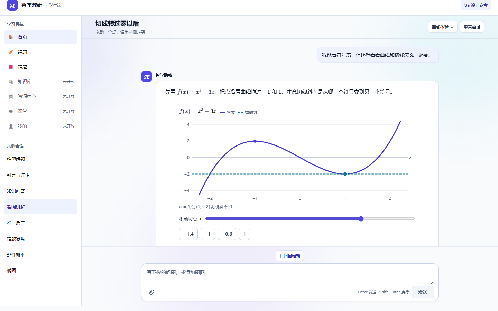

# V5 高保真设计参考图册

下列图片是本包可操作设计参考的 Chrome 截屏，界面上有「V5 设计参考」。其中桌面图为 1440×900，移动图为 390×844。题图是随包自编测试素材，助教内容为预生成样本，交互结果由本机运行产生。

| 画面 | 所看重点 |
| --- | --- |
| [S01 知识问答](./S01-知识问答.png) | 短问题、数学反例、对比表、真实自编讲义 |
| [S01 补充 · 割线趋近](./S01b-割线趋近.png) | 有动作的公式，$h=0$ 的切线分支 |
| [S02 拍照接题](./S02-拍照接题.png) | 真实图片组件，接学生自述的求导经验 |
| [S03 引导作答](./S03-引导作答.png) | 完整题面一次，作答事件留在题目旁 |
| [S04 根据首答反馈](./S04-针对首答反馈.png) | A 的错误落到邻域走势。无需重发原题 |
| [S04 补充 · 另一种证明](./S04b-另一种证明.png) | 实际函数值差式，选择回题或对照另一方法 |
| [S05 动态图形](./S05-动态图形.png) | 切点、切线、斜率和可键盘操作的滑块 |
| [S06 变式首题](./S06-变式首题.png) | 一题一处提交，同一题的后续反馈保持简洁 |
| [S06 补充 · 实际作答汇总](./S06b-实际作答汇总.png) | 真正提交过的首答与最近答，分母来自实际作答 |
| [S07 错题复盘](./S07-错题复盘.png) | 本机实际保存记录，首答与订正可追溯 |
| [S08 条件概率](./S08a-条件概率.png) | 按学生确认的条件问不同的概率 |
| [S08 解析几何](./S08b-解析几何.png) | 换轴追问改变焦点，离心率保持 |
| [S05 移动窗口](./S05m-移动端动态图.png) | 图形读数和输入区仍可操作 |

[打开 V5 设计预览](../../V5设计预览.html) · [V4 原证据清单](../v4/证据索引.json) · [官方竞品界面](../references/官方竞品证据.md)
