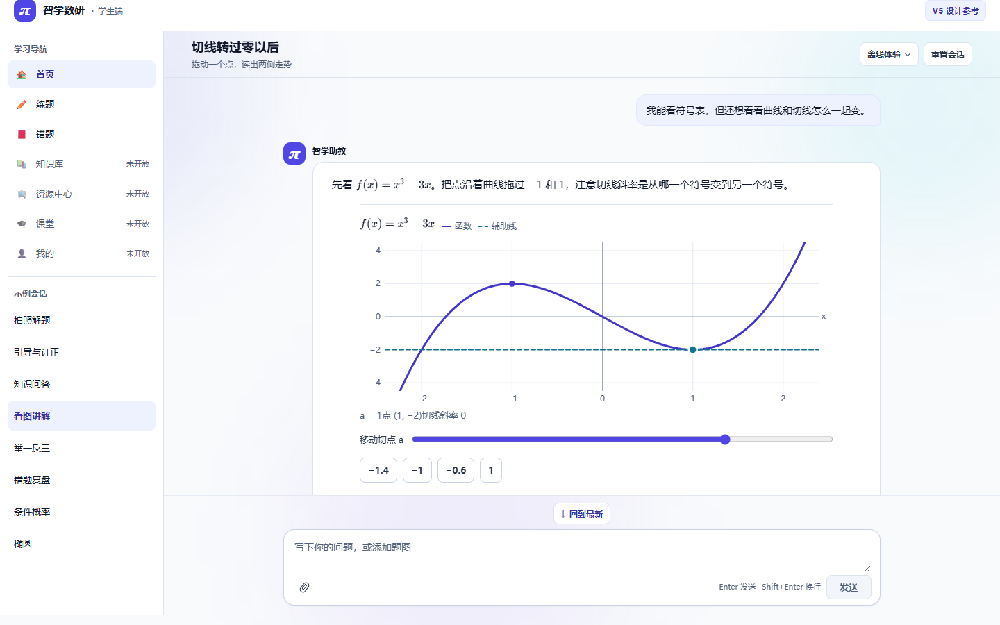

# 智学数研学生端 AI 智能体回答内容与视觉设计基线 V5

2026 年 11 月 25 日 · 设计基线与可操作参考 · 用于学生端离线演示的实现和验收

V5 保留智学数研的紫色品牌、淡紫浅青背景、全导航和宽输入框。主要改造对象是**一条助教回复怎样组织，以及它依据什么继续回答**。学生可以直问、作答、改变方法、用图确认和保存错因。设计验收应检查这些行为如何影响下一条回复。

解压后双击 `V5设计预览.html`。建议依次查看「拍照解题」「引导与订正」「看图讲解」。在导学分别试 A、B、D，再输入一句同义问法看看能否承接。左栏可打开全部八个样例，标题栏可展开「离线体验」。[可操作 HTML 预览](./V5设计预览.html) · [高保真设计图册](./resources/mockups/图册.md)

### 交付位置

| 需要检查的内容 | 文件 |
| --- | --- |
| 实际学生对白、助教全文、分支与支持的输入 | [完整教学样本与分支](./resources/samples/完整教学样本与分支.md) |
| 预览读取的源数据、消息协议与异常样例 | [教学样本 JSON](./resources/samples/V5教学样本与分支.json) · [结构化消息与事件样例](./resources/samples/消息与事件协议样例.json) |
| 原截图、现地发行件复测、原实施计划 | [V4 证据索引](./resources/v4/证据索引.json) · [实施计划原件](./resources/v4/实施计划-原件.md) · [现地发行件复测](./resources/v4/V4现地发行件复测.json) |
| 可核对的公开界面证据、判断和边界 | [官方竞品证据](./resources/references/官方竞品证据.md) |
| 数学复核、编码验收和实际运行证据 | [生成和数学审校](./resources/acceptance/生成与数学审校.md) · [逐场景验收矩阵](./resources/acceptance/逐场景验收矩阵.md) · [Chrome 预览验收](./resources/acceptance/Chrome预览验收.json) · [交付核验](./resources/acceptance/交付核验.json) |

## 1. V4 证据与判定

视觉证据包括本次明示的 15 张截图、同机同批的两张拍照续图和一张拍照开场补证。按前次专项评审场景顺序重建 17 张主证据，保留每张原文件的校验值。原会话读取结果含附件数量与评审文字，未给出附件文件名或原始 HTML 字节。现地以项目自带的 `release/开始演示.html` 和 SHA-256 `82b780575062db338a24e722465f5de186e4128c2fe52ca4d7218c1775c6001b` 为可复测发行件。会话附件与本地文件的字节同一性尚未确认。[原会话](https://chatgpt.com/c/6b04eb4c-ed84-83ea-ac89-0e0899d2befb) · [证据索引](./resources/v4/证据索引.json)

| V4 现象 | 看见了什么 | V5 可据此审查什么 |
| --- | --- | --- |
| 拍照后讲解节奏平 | 01–02 均为同一种连续解释，图形占一大块区域。单从画面难判断图为哪一步服务 | 在识别或确认后只读一次题。按学生已经做到的步骤开始，图形要回答一个具体问题。[题图开场](./resources/v4/photo-context-145102.png) · [讲解与图形](./resources/v4/01-145108.png) |
| 引导重述题面、固定闯关 | 03 首答已在题图旁，下一屏又出现完整题面与首答。04–05 出现读题表、选择方法等统一结构 | 按当时的证据起答。有人答错时先解释这一错步；只请求引导时从诊断问题开始，无须讲完四个阶段。[首答](./resources/v4/03-145135.png) · [读题](./resources/v4/04-145142.png) · [换法](./resources/v4/05-145149.png) |
| 界面操作被重写成用户话语 | 04 和 06 可看到纯操作标题进入学生气泡。14–15 仅凭图不足以断言此前没有提交过答案，但入场提示与紧邻记录脱节 | 「切换解法」「返回题目」「加入错题本」走各自事件。没有已提交答案的来源时，用「你想从哪一步开始」等中性提示。[返回卡片](./resources/v4/06-145207.png) · [按钮后接断言](./resources/v4/15-145334.png) |
| 订正与状态不一致 | 06–07 页首已经完成，当前区域仍可选择。08 既显示订正 C 又写「订正后 0/3」，截图无法证明两个数据口径是否一致 | 同一题的状态和统计读同一组已提交事件。在本题订正提交成功前保留作答态；跨题汇总具名标注统计范围。[重选](./resources/v4/07-145213.png) · [完成小结](./resources/v4/08-145218.png) |
| 无法识别的来源 | 09–10 截图的按钮显示「未命名资料」。本地发行件可展开知识来源，截图和干净会话复测应分别保留 | 强制读取来源标题、章节和摘录。同一处知识只在确有引用时显示来源入口，缺失时省略入口。[知识问答](./resources/v4/09-145227.png) · [本地复测](./resources/v4/V4现地发行件复测.json) |
| 播放图形缺少探索 | 11–12 可见帧图和重播。单帧过渡截图不能证明图长期发白，材料仅能证明它是分帧呈现 | 把可改变的量交给学生。滑块动时，同步更新函数上的点、辅助线及斜率，保留文字读数。[分帧示例](./resources/v4/11-145301.png) · [反例](./resources/v4/12-145308.png) |
| 多层卡片与错题重复 | 13 有外框、题目框、选项双字母、多枚模式标签。16–17 错题复盘重新铺开题干与所有选项 | 一条答复一个轻边界。练习只出当前题，错题保留原题定位、实际首答、最新答、原因和下次检查。[变式](./resources/v4/13-145322.png) · [错题 1](./resources/v4/16-145348.png) · [错题 2](./resources/v4/17-145356.png) |

采用独立设计包承载 V5 内容规范和可运行参考。正式实现接入现学生对话的消息与离线回放边界。现地 V4 复测覆盖 860 px 宽度、预设会话、三帧图、来源展开、附件放大、订正及刷新。已知的本地资源路径提示保留在复测记录。上一轮的三份录制题共 27 轮属于 V4 已有回放证据，V5 新样本以另一套数据标识。[现地 V4 复测](./resources/v4/V4现地发行件复测.json) · [上一轮发行验收](./resources/v4/V4上轮发行验收.json)

## 2. 竞品证据怎样转成设计规则

| 官方界面或演示 | V5 可执行规则 | 审查方法 |
| --- | --- | --- |
| ChatGPT 的学习模式有分层讲解和理解检查，数学科学公告展示了随变量更新的模块 | 知识问答先回应关键疑问。只有足以观察变量关系时加图，读数和公式可同时核对 | 调动切点时，斜率必须与当前横坐标对应。[学习模式](https://openai.com/index/chatgpt-study-mode/) · [互动数学示例](https://openai.com/index/new-ways-to-learn-math-and-science-in-chatgpt/) |
| Claude 官方演示行内图表，另有带独立预览的成果视图 | 解当前题的小图在回答中展开。需要持续操作和回看的图，在未来可扩大为独立面板，正文保留结论 | 放大或收起状态只影响当前组件。滚动前后公式和图仍能找到。[行内图形](https://claude.com/resources/articles/claude-builds-visuals) · [公开界面案例](https://academy.claude.com/use-cases/visualize-the-mechanism-behind-an-explanation-mid-chat) |
| Manus 官方录制演示把真实任务活动与打开文件对应呈现，公开接口列出工具和计划事件 | 只有实际执行且与学生任务相关的工作才显示状态，复盘可看真实产物 | 找不到工具调用和结果时，界面只显示讲解正文。[首发视频简历段 0:44–0:54](https://www.youtube.com/watch?v=K27diMbCsuw&t=46s) · [事件文档](https://open.manus.im/docs/v2/task.listMessages) |
| Gemini 公告展示同题的直接解答和引导式回答，引导先问一个可回应的概念 | 已明确要结果时先给结论与足够依据。愿意自己做时拆出一个关键问题 | 身份、题目相同，快答和引导应走不同长度和结构。[同题对照](https://blog.google/products-and-platforms/products/education/guided-learning/) |
| Brilliant Koji 官方说明和画面在共享题目上高亮当前一项并提供可拖答案 | 错步解释和证据就在原题定位附近。从实际选的项或写的式子落笔 | 选择 B 后要见到 $g'(1)=-12$，选择 D 后要解释测试点 $−2$。[Koji 官方画布](https://brilliant.org/help/features/how-does-koji-work/) |

本轮依据公开资料和示例画面。竞品的登录态交互、题库覆盖和教育成效未做实测。样式和回答组织均按智学数研设计，引用仅供编码与视觉审查。详见带来源位置的[竞品证据](./resources/references/官方竞品证据.md)。

## 3. 回答基线

### 以最近一条有证据的学生行为起答

| 输入或事件 | 可用证据 | 助教应如何回应 |
| --- | --- | --- |
| 直接概念提问或问结果 | 原文、相关题目、已确认题面 | 一到两句解决主问题。用一个例子、式子或反例给依据。复杂证明可以独立展开展示 |
| 学生已给出中间式或选项 | 原式、实际选项、对应题目 ID、最新作答 | 指出这一步哪一处有效，哪一处需要改。问题只落在一个可以回答的判断上 |
| 只有「开始引导」界面事件 | 当前题、学生尚无选项或当前已选项 | 有实答就接着它。其余情形询问学生做到哪里，或给候选点找法 |
| 选择看另一种方法 | 当前题、已确认的数学事实、当前方法 | 展示新方法的证据，沿用双方已确定的结论。把新方法需要证明的环节重新证起来 |
| 图形、来源、导航、保存 | 组件状态、目标资源、保存结果 | 在组件、详情面板或当前区域反馈。记录动作，但不合成学生气泡 |
| 输入超出预设范围 | 原文和当前节点 | 显示范围提示，保留草稿、当前答题状态及选择。可继续用已支持的问法，或点当前操作 |

讲法可以长短不同。下面是三个容易在编码时被做平的例子。

- **学生问「水平切线就是极值吗？」** 先区分斜率与高低，再用 $x^3$ 的任意 $\delta>0$ 左右取值说明。短问题用短答案。学生追问割线时，才展开差商和可操作图。
- **选 A 的学生**已经给出了位置 $-1$。可以说「你选的 $-1$ 的确让导数等于零」，不能说学生已经分解导数。展示离 $-1$ 左右很近的点，然后让学生选择峰顶或谷底。把正负顺序读反时，再用上坡下坡作解释。
- **学生选 B 或 D**分别解释「还位于下降区间」和「区间测试点可用于验符号，却不是候选点」。答对 C 可以两句结束，想换成函数值比较的人可随时展开另一证法。

一条回复有一个主要意图和一个轻边界。公式可成行，符号区间可写成表，动态图和题卡有自己的内在交互。长解释按照证明依赖排序，短反馈无需标题、摘要或谢谢式结尾。出处只随需要引证的结论出现，资料名、章节和摘录落到可开的实体。[完整样本](./resources/samples/完整教学样本与分支.md) · [实际自编讲义](./resources/references/自编讲义-导数与极值.md)

## 4. 主线与少量迁移场景

V5 把拍照题和导学统一到 `problem.g`，这样同题回看可以引用一处完整题面。看图特意另用 $x^3-3x$，解释方法可迁移，数值不沿用。下面的输入均可用页面操作重现，完整对白和所有分支为样本数据。

| 场景 | 学生可以做什么 | 可见成果与应变 |
| --- | --- | --- |
| S01 知识问答 | 问 $x^3$ 在原点为何没有极值，追问割线或不可导的极值 | 显示反例和可打开的自编讲义。追问割线显示 $h\ne0$ 时的差商，$h=0$ 看极限切线 |
| S02 拍照 | 打开题图、展开完整解析。用随包的截断图测试末项确认 | 同图只引用一次。明确对应 $g(x)=2x^3-3x^2-12x+1$。图片内容通过本地样本识别，截断路径让学生确认「+1」 |
| S03 引导 | 选 A、B、C 或 D，也可以输入「我没思路」 | A 接局部走势，B/D 接不同代值证据，C 可以直接结束，未选时给短提示 |
| S04 纠错与换法 | 说「函数值为正所以在上升」；把先升后降误判为谷底；切换函数值法后再答 | 以 $g(0)=1,\ g'(0)=-12$ 拆清高度和方向。另一方法用附近差式，最后提交 C 才写实际订正 |
| S05 动态函数 | 调 $a$，比较 $-1.4,-1,-0.6$ 和 $1$，切换同号反例 | 输出当前点、切线及数值斜率。调整滑块只改图形。看 $x^3$ 可验证水平切线与极值的差别 |
| S06 变式 | 逐题交答案，错了可再试 | $x^3-12x$ 换系数，$-x^3+3x$ 改走势，$(x-1)^3$ 检查同号。最后显示已提交记录 |
| S07 错题 | 实际答错、订正后选择保存，刷新查看 | 首答、最近答、原题定位和针对性检查。首次打开空态。重复保存同一会话题目只应有一条 |
| S08 条件概率和椭圆 | 「第一次没说颜色」改变抽球问题，或交换椭圆分母 | 条件、边际和交集分别解释。交换分母改变焦点所在轴，离心率仍为 $4/5$ |

主线一次验收可以走 `S02 → S03 → S04 → S07 → S06`，另开 `S01 → S05` 检查概念和图形。网站内的场景切换保留各自的样例会话。本预览在 S03 和错题本间传递真实保存记录，话题互跳不会生成历史作答。正式实现承接同一题目时，应显式传入题目与提交 ID。

### 作为视觉验收的具体画面

以下是 V5 可操作预览的 Chrome 实拍，界面带有「V5 设计参考」。原 V4 截图和产品样例均可在各自索引中找到。

来源、完整解析、另一种证明、订正保存与移动窗口等图示列在[高保真设计图册](./resources/mockups/图册.md)。

## 5. 视觉与交互规范

| 项目 | 基线 | 实现与审核 |
| --- | --- | --- |
| 产品外壳 | 紫 `#4F46E5`、深文字 `#0F172A`、浅底 `#F8FAFC`，保留原有三处光斑与导航 | 原导航顺序、品牌标记和底色都保持在设计参考里。导航未实现的区域在参考中明示，后续代码沿用现产品入口 |
| 对话与输入 | 桌面共用 860 px 内容列，输入与其左右对齐，可编辑高度 ≥44 px | 1440×900 和 1906×1035 核对浏览器尺寸。窄屏先收边距，输入随内容列缩放。消息区独立滚动 |
| 轻量回复边界 | 1 px `#DBE3EF` 边框、16 px 圆角、`#FFFFFF` 底，一层容器 | 助教标识在边界上方，左侧头像轻量。间距约 24 px。正文 15 px、行高 1.75，左右内距随宽度 15–27 px |
| 数学与表 | 公式用 KaTeX 等经过验证的数学渲染。行内用于称谓，断行或多步骤使用块公式。区间表有列标题与首列语义 | 不把公式栅格化。狭窄窗口公式与表在内区横向滚动，整页不溢出 |
| 图形 | 曲线使用紫色实线，切线或割线用青色虚线，另外显示当前点、数值与图例 | 横轴 $a$ 与导数同源计算。图中信息同时有文字，滑块支持箭头和有名字的预设点。色彩只帮识别 |
| 作答区 | 一组互斥动作，完整题面只在当前题出现一次，回看显示已选值 | 选项字母只出现一次。同一步确认后收起操作，保留结果。订正可引用题目简写 |
| 原因与来源 | 原因可用一处轻提示。来源只能打开实际标题、章节与摘录 | 小说明不与正文复读。出处少则一行，较长可展开，缺字段不画空卡 |
| 回放与焦点 | 准备完的内容立即首屏可读。回放按段提供，支持停止与续看。恢复时维持当前内容版本 | 减弱动效时完整呈现。焦点可见、可键盘操作。上翻回看后给「回到最新」，组件操作不卷走阅读位置 |

功能字号优先清晰。正常文本颜色至少 4.5:1，重要焦点和控件边界的测试目标为 3:1。使用文本和数值解释正负及对错。预览在 390 px 显示可开合导航，720×450 保留窄窗口对话与输入，正式实现仍应另测实际机型、触屏与读屏工作流。

## 6. 离线状态和消息契约

### 能力与文案

统一说明文案可以是「这里提供预生成的数学讲解和可操作练习。图形在本机计算，可用的追问随示例而定。」预览标签「V5 设计参考」用于评审，实际展出保留面向游客的「离线体验」入口。运行期间在本机读取素材并处理有限的已支持输入。可以随时退出当前练习。

| 状态或事件 | 界面呈现 | 记录要求 |
| --- | --- | --- |
| 空会话/样例开场 | 实际空态或明确的样例起始历史 | 样例历史与当次用户提交用不同来源字段 |
| 附件就绪/需确认 | 清晰题图可发送。首次实际上传从中性题面接起，样例历史保留在样例入口。已知截断样本先问末项 | 校验本地文件与已准备样本。真实 OCR 支持留给未来实现或既有已采录链路 |
| 有支持的学生文本 | 学生气泡显示提交原文，随后按已覆盖的分支展示预设讲解 | 有节点作用域、原文、归一值和识别到的分支。短句比对保留否定语义，模糊时回到范围提示 |
| 有效控件事件 | 方法切换只展示相应解释，选项作为本步实际答案，图形原地更新 | 使用 `interaction.kind` 携带题目、目标和事件 ID。只有真实文本写 `role=user` |
| 可暂停的回放 | 明示正在回放预设讲解。停止时冻结已见内容，继续时沿同一轮 | 只保存一次已接受事件。输出进度和数学状态分开。重新加载后可续看未完成段落 |
| 不支持或附件未知 | 给有限范围和恢复办法。输入草稿留在编辑区，当前题和答题状态保留 | 不套用录制下一轮，不增加作答计数。可以记录本机未匹配事件，产研日志不映射成用户历史 |
| 订正与入库 | 本次实际首答、最近错答和最近作答。持久写入成功才显示「已保存到错题本」，失败时显示「本窗口已记录」。再次点无需新增 | 本次会话与题目组成保存键。运行时区分提交成功、已展示和保存成功 |
| 来源缺失/出错 | 缺字段时不显示引用。如果存在真实文件但读不出摘录，告诉用户该资料暂不可打开 | 来源由真实清单解析。禁止用通用占位假装检索完成 |
| 断网/存储不可用 | 功能已设计为断网可用。存储不可用时提示本窗口仍可体验 | 不发外网请求。会话状态不进入正式站的数据存储。功能回退写进测试 |

### 推荐的内容结构

`role`、`origin` 和 `blocks` 描述消息。`eventId`、`action`、`sceneId` 和 `problemId` 描述事件，`packVersion`、`runId`、`expectedTurnId` 和 `expectedNode` 标明事件能够作用的版本与轮次。图形、来源等稳定资源事件只在当前资源上生效。建议块类型包括正文、公式、表、题目引用、图形、引用和作答回执。块保留原顺序且有稳定 ID。

事件顺序为「校验当前场景和版本 → 规范输入 → 决定命中或覆盖范围提示 → 追加实际事件 → 更新可证事实与当前题 → 装入有出处的答复块 → 保存和重绘」。校验轮次令牌并去重后再更新记录。回到同一个节点时用新的轮次令牌，防止之前的控件事件作用到这一次。滚动、打开来源、预览题图等无需推进题目。对于同一题，保存键为会话运行 ID 与题目 ID。按提交顺序取首答、最近一次错误和最近作答。没有实际错答时省略错因入库入口。同一组变式的统计由唯一题 ID 聚合。

图形块保持函数 ID 和参数域。使用完全可复算的公式得到当前点与切/割线。在 $y=x^2$ 的例子里，$h=0$ 直接计算导数 $2$，割线差商只在 $h\ne0$ 使用。工具状态的未来接入以实际可回放事件为依据，V5 不使用预测进度、虚假检索和泛化的验算徽标。录像或教学脚本不能替代作答事实。[消息与事件实例](./resources/samples/消息与事件协议样例.json)

### 正式实现的落点

1. 先把 V5 样本与事件读写放在现有离线回放边界，分离「现役录制」和「V5 预备讲解」的来源。使用稳定的知识点、题目与版本 ID。
2. 利用 `DialogView.vue`、`MessageBubble.vue` 和现有消息、历史还原机制接入有序富内容。正式实现建议用对话消息兼容适配器和独立的界面事件，沿用 `useChat` 文字发送入口。未知块退化到实际可读的正文。
3. 选择卡、展开动作、图形与入库分别按契约接入。实现中为事件准备幂等键和可回看状态，首答从真实提交获取。逐题解耦当前答案和历史答复。
4. 第一阶段验收先跑拍照、问答、A/B/D 的错因与一条订正。再做图形联动和入库，最后加迁移样本、相同语义不同表达及三端回归。

此处给的是后续编码接口与验收顺序。V5 浏览器参考和机器样本已独立交付，正式项目本轮保持只读。

## 7. 逐场景审查与边界

先按矩阵从干净 Chrome 上下文走主线，再测试换法、界面事件、未匹配文本、连续点击、刷新与窄窗口。验收记录至少留一张完整首屏、一张针对错误的回复、一张承接结论的动图状态（或多状态截图），以及本地状态与网络摘要。[逐场景验收矩阵](./resources/acceptance/逐场景验收矩阵.md) · [预览检查记录](./resources/acceptance/Chrome预览验收.json)

| 用途 | 本轮可凭证据确认 | 后续产品验收 |
| --- | --- | --- |
| V4 现状 | 本机发行件单文件运行、历史、缩放、三个分帧图、预设导学，既有录制链路可查 | 保证 V5 接入后仍通过三端现有路由和原录制用例 |
| V5 内容 | 本次 Codex 模型预生成的全量台词、知识与视觉结构。按样本逐式验算，错误入口和事件规则可审查 | 学校数学教师按本地课程口径签审长尾表述、教学节奏，项目方确定正式发布范围 |
| V5 可操作参考 | 使用本地题图库、有限意图、公式、可调曲线、暂停/续看、本机保存与回看 | 真实 OCR、新问题求解、联网检索和账号同步需要另建能力及证据 |

本轮作了两项具体设计选择。拍照与导学共用一道三次函数题，另用更简洁的三次函数解释图形。高中扩展示例只选条件概率与椭圆，用于检验回答结构能否迁移。预览据此设计了有限的可运行支路，正式接入时可以扩充经审校的样本库。[生成与审校记录](./resources/acceptance/生成与数学审校.md)
